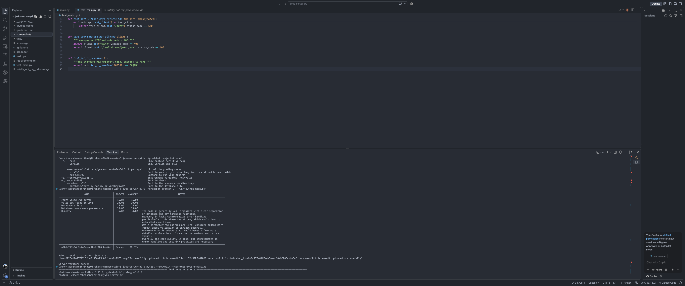
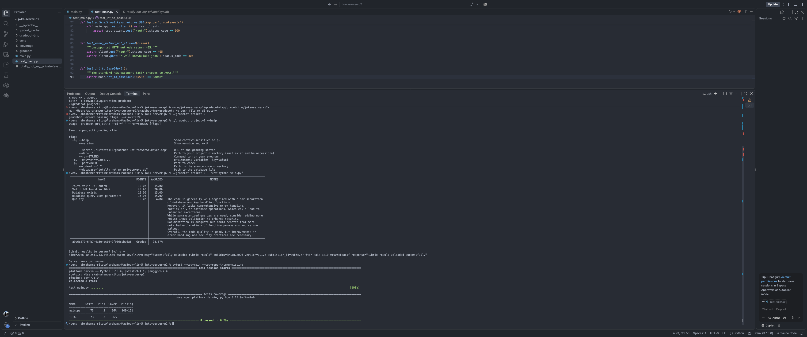

# JWKS Server with SQLite (CSCE 3550 Project 2)

Abraham Cerritos — aaf0189

Flask JWKS server that stores RSA private keys in SQLite
(`totally_not_my_privateKeys.db`) using parameterized queries.

## Run

```bash
python3 -m venv venv
source venv/bin/activate
pip install -r requirements.txt
python main.py
```

The server runs on `http://127.0.0.1:8080`.

## Endpoints

- `POST /auth` returns a JWT signed with a valid key (or an expired key with `?expired`)
- `GET /.well-known/jwks.json` returns the public keys for all unexpired keys

## Test

```bash
pytest --cov=main --cov-report=term-missing
```

## Screenshots

### Gradebot results


### Test coverage
